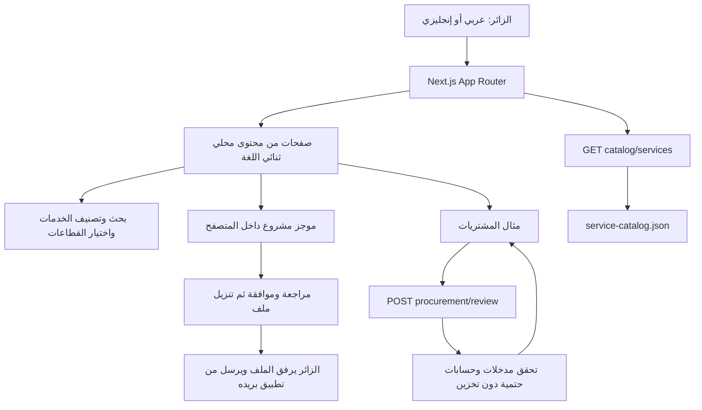

2026-10-24 content-only preview: page copy/metadata and local rendering updated; existing routes/APIs/data/runtime unchanged. [Receipt](releases/content-preview-2026-10-24/README.md). Wider self-service product generation remains a separate implementation scope.

# الخطة التقنية وخريطة التنفيذ

الحالة الحالية: موقع ثنائي اللغة وحسابات وموجزات دائمة وAgent Studio A–E منشورة، ثم إصلاح المحادثة وإزالة قسم API المرئي. [التقرير الشامل](CURRENT-IMPLEMENTATION-2026-10-20.md) يربط التنفيذ بالأدلة. آخر تغيير منتج `4b7b5a2`؛ مسودة المرحلة 3 منفصلة عن التشغيل الفعلي.

## 1. البنية الموجودة

هذا الرسم يصف المسار الأصلي قبل تسليم الحسابات. أضيف الآن التسجيل والجلسات وprofiles/project_briefs مع RLS وحفظ الموجز من واجهة المراجعة؛ أضيف لاحقًا Studio ومزود Groq كما يوضح القسم التشغيلي أدناه. Analytics وSpeed Insights أدوات قياس؛ ليستا مخزن طلبات المشاريع أو سجل تنفيذ وكلاء.

## 2. التقنية والتشغيل

| الجزء | التنفيذ |
|---|---|
| التطبيق | Next.js 16.4.0 / React 19.2.4 / TypeScript 5.7.3 |
| الأنماط | Tailwind CSS 4 وقواعد مشتركة في `app/globals.css` |
| مدير الحزم | pnpm 12.3.4 و`pnpm-lock.yaml`؛ الإصدارات المحلولة يحكمها القفل |
| بيئة التحقق المحلية | Node.js 26.8.2؛ نسخة Node السحابية ليست مثبتة بهذا الرقم في التوثيق |
| الاستضافة | مشروع `vzero`، فريق `adhamlouxors-projects`، Vercel Git Integration |
| الإنتاج | `main`؛ النطاق `vzero-nine-beryl.vercel.app` |
| الأوامر الموجودة | `dev` و`build` و`start`؛ لا مهمة lint معرفة |
| بيانات المنتج | المحتوى JSON/TS؛ الحسابات والموجزات وStudio في Supabase مع RLS؛ لا CMS |

## 3. خريطة الملفات والمسؤوليات

المسارات التالية نسبية لجذر المستودع:

| الملفات | المسؤولية |
|---|---|
| `app/layout.tsx`, `proxy.ts` | `lang/dir` من المسار؛ Shell والخطوط وOrganization schema والقياس. يعيد proxy ضبط ترويسة اللغة من URL |
| `app/page.tsx`, `app/[...path]/page.tsx` | الرئيسية والتوجيه والتحقق من الصفحات واللغة وmetadata و404 |
| `lib/site-routes.ts`, `app/sitemap.ts`, `app/robots.ts` | عناوين اللغتين وSEO وخريطة الموقع واستبعاد API من الزحف |
| `lib/service-catalog.json` | 10 خدمات ثنائية اللغة بتفاصيل المدخلات والخطوات والمخرجات والضوابط وFAQ وSEO |
| `lib/agynexa.ts` | 9 حلول، عناوين التنقل والملخصات |
| `lib/program-pages.json`, `lib/solution-service-map.json` | محتوى الصفحات التحريرية والربط بين الحلول والخدمات |
| `@components/agynexa-shell.tsx`, `@components/locale-link.tsx` | التنقل والتذييل وتبديل اللغة وروابط تحافظ على المسار |
| `@components/agynexa-pages.tsx`, `@components/agynexa-sections.tsx` | تجميع الصفحات وأقسام الرئيسية والحلول |
| `@components/service-directory.tsx`, `@components/service-catalog.tsx` | البحث والتصنيف وعرض تفاصيل الخدمة |
| `@components/program-layouts.tsx`, `@components/system-diagram.tsx` | اختيار القطاعات والمكونات المتخصصة ورسم البنية الأصلي |
| `@components/procurement-review.tsx`, `lib/procurement.ts` | واجهة المثال والتحقق والحسابات |
| `@components/project-brief.tsx` | مراجعة وموافقة وحفظ خادمي للمستخدم، وتنزيل وmailto |
| `app/api/v1/catalog/services/route.ts` | إسقاط عام لمحتوى الكتالوج |
| `app/api/v1/procurement/review/route.ts` | API عام عديم الحالة محدود المدخلات والحجم |
| `@ui/`, `@hooks/`, `tsconfig.json` | مكونات القالب وaliases؛ الاستيراد `@/components/ui/*` يحيل إلى `@ui/*` |
| `tests/procurement.test.mjs`, `tests/http-smoke.mjs` | فحوص الحسابات والحدود وعينة الصفحات وSEO |

لا تعدّل نسخ المكونات المتشابهة في `components/ui` على افتراض أنها المستخدمة؛ تحقّق من alias والاستيراد الفعلي.

## إضافة واجهة المرحلة 4 المنشورة عبر PR #9 (`dc62aac`)

`@components/agentnexos-intro.tsx` وCSS module يعرضان النص القائم من `lib/program-pages.json` فوق `public/images/agentnexos-neural.webp` عبر Next Image. نسخة العربية تعكس التكوين، والجوال يخصص للصورة 320px أعلى المحتوى في القسم نفسه. استيراده شرطي في ProgramPage للـAgentNexOS فقط. لا تعديل للـAPI أو المسارات أو البيانات أو التبعيات.

خفض PR #9 overlay إلى 5%، ثم أزالت المرحلة A المنشورة tint المتبقي إلى transparent. المرجع الحالي `app/globals.css`؛ دون filter للفيديو. مكونات Tailwind ذات أخضر مستقل باتت تستخدم primary، والزر المشترك يحفظ اللون عند hover مع إطار للتمييز. بيئة فحص هذا المرشح Node 24.19.0، والتبعيات القائمة؛ لا تثبيت أو ترقية للقفل. [الدليل](evidence/visual-repair-2026-10-19/verification.json).

## 4. المسارات والمحتوى

الإنجليزي دون بادئة، والعربي تحت `/ar`. الصفحة العربية لها HTML عربي من الخادم و`dir=rtl`. تبديل اللغة يحتفظ بالصفحة الحالية. عدد العناوين الأساسية **64**؛ [الجرد الحالي](current-routes.json) يوضحها كاملة. `/services/solutions` و`/ar/services/solutions` يحيلان إلى كتالوج اللغة نفسها ولا يدخلان sitemap. `/contact` يقدم نموذج الموجز نفسه، وهو صفحة أساسية منفصلة حاليًا عن `/start`.

المحتوى التجاري يصف خدمات تصمم وتنفذ وفق عقد ونطاق. أسماء ServiceFlow وما شابه تبقى أسماء تخطيط داخلية تحتاج فحصًا تجاريًا؛ العناوين العامة وصفية. لا توجد شهادات أو نتائج عملاء مختلقة. راجع [نموذج المحتوى](content-model.md) و[service-mapping.csv](service-mapping.csv).

## 5. عقد التصميم

| الدور | القيمة |
|---|---|
| خلفية | `#050505` |
| سطح | `#0B0B0B` |
| أخضر أساسي موحد | `#10B981` / `rgb(16,185,129)` |
| نص / نص ثانوي | `#EBEBEB` / `#BFBFBF` |
| حد | `#EBEBEB26` |

المرجع القيمي: قياسات AGYNEXA والقالب، لا ألوان Kore.ai. التكوينات متنوعة: رسم مقابل نص، فهرس خدمات، محدد قطاعات، دليل تكاملات، خط زمني، تفاصيل قابلة للفتح، مساحة مقارنة، نموذج مراجعة. [DESIGN.md](../../DESIGN.md) يشرح الخطوط والمقاسات والمكونات؛ المصدر المحسوب في المتصفح يحسم أي اختلاف.

تاريخ التعتيم: أصلحت المرحلة 4 القيم إلى 28%/13% و24% للجوال، ثم وصل إصدار PR #9 إلى 5% موحدة. ثم أزالت المرحلة A المنشورة tint إلى transparent؛ تقرير A يحفظ التحقق المحلي وقتها. الفيديو نفسه دون filter أو تبديل. [فهرس الأدلة](evidence/README.md) يتضمن بصمات الأصول واللقطات. هذه الحماية لثلاثة ملفات أصلية؛ ملفات CSS وShell المشتركة تغيّرت ضمن التفويض.

## 6. مسودة المرحلة 3 مقابل التشغيل اللاحق

| مجال التصميم | الأثر المحفوظ | متطلب تحويله إلى تشغيل |
|---|---|---|
| عقود الخدمات | [OpenAPI المقترح](architecture/openapi.yaml)، [Zod draft](architecture/contracts.zod.ts.example) | تحديد المستهلك والعقد النهائي، ثم handler واختبارات وحدود وصول |
| البيانات والعزل | [20 جدولًا وERD](architecture/data-model.md)، [SQL review](architecture/schema-review.sql) | بيئة معزولة، مصادقة وأدوار، migrations معتمدة، سياسات وإجراءات واختبارات RLS |
| التكاملات | [20 مزودًا مرشحًا](architecture/integration-matrix.csv) | اختيار مزود وحساب، إثبات endpoints/scopes/signatures والأسعار، صلاحيات مفوضة واختبارات |
| التشغيل والموافقات | [عقود سير العمل](architecture/workflow-contracts.md) | حالة دائمة، outbox، idempotency، مراجعة مربوطة بهوية وفعل محدد، تدقيق واسترداد |
| الاسترجاع | [نموذج البيانات](architecture/data-model.md) | اختيار مصادر ونموذج embedding وعزل ACL، فهرسة وإبطال الوصول والمراجع |
| الأمان | [نموذج المخاطر](architecture/threat-model.md) | تنفيذ الضوابط واختبارها؛ النص المكتوب وحده لا يثبت الامتثال |

SQL مسودة للمراجعة تنتهي بـ`ROLLBACK` ولم تُشغل. تصميم RLS يمنع الوصول افتراضيًا ولا يمثل backend قابلًا للاستخدام. أبعاد embeddings لم تُختر؛ Groq متصل في runtime Studio النصي الحالي، وليس في SQL المسودة. لا توجد مفاتيح أو حسابات تكامل أو Supabase يجب استنتاجها من مجرد وجود هذه الملفات.

## 7. التشغيل الحالي ومصادره

| الملفات | المسؤولية الفعلية |
|---|---|
| `lib/supabase-health.ts`، `app/api/health/supabase/route.ts` | فحص مشروع xsyxvswbiptbyxyqhdim والمفتاحين، قراءة فقط؛ العام عبر Auth settings والسري عبر Data API |
| `app/api/auth/*`، `app/api/account`، `app/api/v1/project-briefs` | تسجيل مباشر بلا بريد وجلسات وملف الحساب وموجزات المستخدم؛ حدود الحساب في تقريره |
| `lib/studio/server.ts`، `settings.ts`، `validation.ts` | جلسة وعضوية ومساحة مالك ووكلاء ومسودات مع revision والتحقق من المدخلات |
| `lib/studio/runtime.ts`، `provider.ts`، `models.ts` | استرجاع نصي واستدعاء Groq وتكرار آمن وتشغيل محفوظ ومقارنة واستهلاك واستشهادات |
| `lib/studio/conversation.ts`، `presentation.ts` | تحية وتعريف ثابتان بلغة الرسالة، أسماء أنماط وحالات مترجمة؛ ليست ردود التعريف استدلال Groq |
| `lib/studio/publishing.ts` | إصدارات وAPI وwidget؛ معرفة عامة مصرح بها وجلسات محدودة |
| `@components/studio.tsx`، `@components/studio-agent.tsx` | محادثة افتراضية ومعرفة وإعدادات وسجل ونشر؛ قسم API المرئي محذوف |
| `supabase/migrations/*` | المخطط التشغيلي الفعلي، منفصل عن مسودة architecture/schema-review.sql |

مسار التنفيذ: مستخدم وجلسة → عضوية/RLS → وكيل ومصدر نصي → استرجاع بالكلمات → Groq عند وجود معرفة مناسبة → استشهادات أصلية وتشغيل محفوظ. التحية/التعريف الكاملان مسار ثابت محدود، والأسئلة المختلطة لا تتجاوز الاسترجاع. ServiceFlow يقترح سجل دعم داخليًا يوافق عليه المالك، ولا يرسل إلى CRM أو بريد.

التسجيل ينشئ حسابًا مؤكدًا خادميًا دون إثبات ملكية البريد؛ لا تفويض بهوية بريد أو metadata. CRUD المستخدم مع جلسة وRLS. المخطط الحالي بخمس migrations؛ [إيصال Studio](agent-studio/evidence/stage-cde/database.json) يربط timestamps المستضافة والمحلية. لا إعادة تطبيق عمياء ولا DROP عند تراجع الكود.

## 8. الإعدادات وحدود التشغيل

أسماء المتغيرات دون قيم: `NEXT_PUBLIC_SUPABASE_URL`، `NEXT_PUBLIC_SUPABASE_PUBLISHABLE_KEY`، `SUPABASE_SECRET_KEY`، و`GROQ_API_KEY` و`GROQ_API_KEY_2` و`GROQ_API_KEY_3`. Secret/Groq خادمية فقط. `AGYNEXA_STUDIO_ENABLED=false` يعطل Studio؛ مفعّل افتراضيًا. الاختبارات المحلية المعزولة لها إعدادات loopback في تقاريرها، ولا تنقلها إلى Vercel أو تستعمل قاعدة الإنتاج عوضًا عنها.

slot1/slot2 للإنتاج والمقارنة الاختيارية؛ slot3 Preview داخلي فقط. قدرات السجل تصف المزود، بينما المنتج نصي. الأسعار في السجل تقديرات مؤرخة وليست فوترة. لا queue/outbox أو embeddings أو PDF أو OAuth خارجي. [المتبقي](BACKLOG.md).

الجرد الحالي: 34 عملية في 26 ملف route؛ [حالة APIs](architecture/API-STATUS.md) و[العقد](architecture/current-api.openapi.json). المصادر وحدود التحقق والنشر في [C/D/E](agent-studio/STAGES-CDE.md)، [إصلاح المحادثة](agent-studio/CHAT-FIX.md)، [إزالة قسم API](agent-studio/API-UI-REMOVAL.md). لا تبنِ حكمًا عن الإنتاج من تقارير B المحلية وحدها.

## مرشح الواجهة — PR #30

`breadcrumbs.tsx` يربط تسلسل المسار، و`workflow-example.tsx` يعرض مثالًا موسومًا. Shell يعرض AR/EN ويحفظ query/hash ويغلق القائمة بـEscape. ProjectBrief يستخدم تحققًا محليًا وحقولًا اختيارية بمساعدة صريحة؛ يرسل نفس عقد briefInput الحالي. API وroutes وDB والتبعيات دون تغيير. اسم أكبر ونصوص/حقول موحدة في CSS؛ تعتيم 46%/55% لتوضيح النص، مع الفيديو ومكوني Hero الأصليين والتشغيل التلقائي دون أزرار. [التحقق والحدود](releases/VISUAL-UPGRADE-2026-10-20.md).

## متابعة النشر والحسابات

`authFailure` في lib/supabase/server.ts يميز 429 و503 عن 401 في signedIn وlogin؛ استجابات عامة no-store، دون retry أو تعديل cookies أو DB. [الدليل](releases/CONTINUATION-2026-10-20.md).
