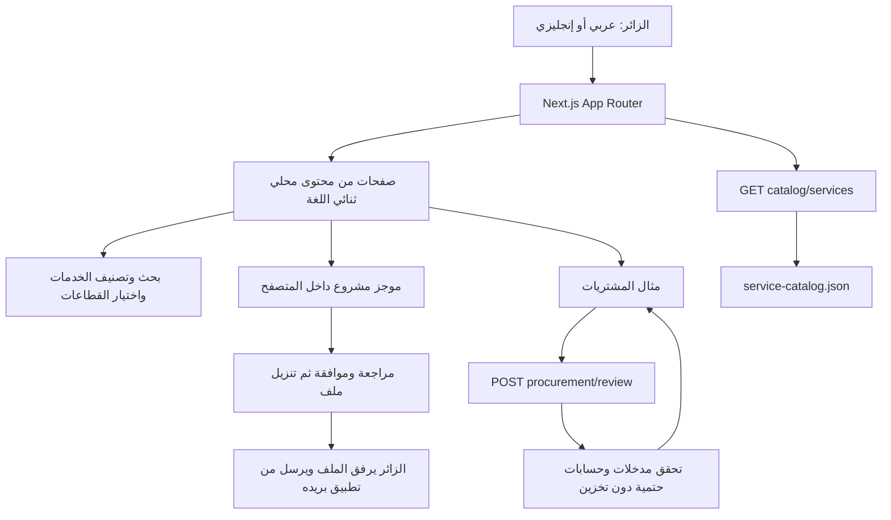

# الخطة التقنية وخريطة التنفيذ

الحالة عند إصدار المنتج `991deca` / دمج `f6e92b3`، 19 أكتوبر 2026. راجع [حالة المراحل](STAGE-MATRIX.md) قبل تفسير أي مخطط على أنه نظام منشور.

## 1. البنية الموجودة

لا توجد طبقة قاعدة بيانات أو مزود نماذج أو تسجيل دخول في هذا المسار. Analytics وSpeed Insights أدوات قياس؛ ليستا مخزن طلبات المشاريع أو سجل تنفيذ وكلاء.

## 2. التقنية والتشغيل

| الجزء | التنفيذ |
|---|---|
| التطبيق | Next.js 16.4.0 / React 19.2.4 / TypeScript 5.7.3 |
| الأنماط | Tailwind CSS 4 وقواعد مشتركة في `app/globals.css` |
| مدير الحزم | pnpm 12.3.4 و`pnpm-lock.yaml`؛ الإصدارات المحلولة يحكمها القفل |
| بيئة التحقق المحلية | Node.js 26.8.2؛ نسخة Node السحابية ليست مثبتة بهذا الرقم في التوثيق |
| الاستضافة | مشروع `vzero`، فريق `adhamlouxors-projects`، Vercel Git Integration |
| الإنتاج | `main`؛ النطاق `vzero-nine-beryl.vercel.app` |
| الأوامر الموجودة | `dev` و`build` و`start`؛ لا مهمة lint معرفة |
| بيانات المنتج | JSON وTypeScript داخل المستودع؛ لا CMS أو DB متصل |

## 3. خريطة الملفات والمسؤوليات

المسارات التالية نسبية لجذر المستودع:

| الملفات | المسؤولية |
|---|---|
| `app/layout.tsx`, `proxy.ts` | `lang/dir` من المسار؛ Shell والخطوط وOrganization schema والقياس. يعيد proxy ضبط ترويسة اللغة من URL |
| `app/page.tsx`, `app/[...path]/page.tsx` | الرئيسية والتوجيه والتحقق من الصفحات واللغة وmetadata و404 |
| `lib/site-routes.ts`, `app/sitemap.ts`, `app/robots.ts` | عناوين اللغتين وSEO وخريطة الموقع واستبعاد API من الزحف |
| `lib/service-catalog.json` | 10 خدمات ثنائية اللغة بتفاصيل المدخلات والخطوات والمخرجات والضوابط وFAQ وSEO |
| `lib/agynexa.ts` | 9 حلول، عناوين التنقل والملخصات |
| `lib/program-pages.json`, `lib/solution-service-map.json` | محتوى الصفحات التحريرية والربط بين الحلول والخدمات |
| `@components/agynexa-shell.tsx`, `@components/locale-link.tsx` | التنقل والتذييل وتبديل اللغة وروابط تحافظ على المسار |
| `@components/agynexa-pages.tsx`, `@components/agynexa-sections.tsx` | تجميع الصفحات وأقسام الرئيسية والحلول |
| `@components/service-directory.tsx`, `@components/service-catalog.tsx` | البحث والتصنيف وعرض تفاصيل الخدمة |
| `@components/program-layouts.tsx`, `@components/system-diagram.tsx` | اختيار القطاعات والمكونات المتخصصة ورسم البنية الأصلي |
| `@components/procurement-review.tsx`, `lib/procurement.ts` | واجهة المثال والتحقق والحسابات |
| `@components/project-brief.tsx` | نموذج محلي، مراجعة وموافقة وتنزيل وmailto |
| `app/api/v1/catalog/services/route.ts` | إسقاط عام لمحتوى الكتالوج |
| `app/api/v1/procurement/review/route.ts` | API عام عديم الحالة محدود المدخلات والحجم |
| `@ui/`, `@hooks/`, `tsconfig.json` | مكونات القالب وaliases؛ الاستيراد `@/components/ui/*` يحيل إلى `@ui/*` |
| `tests/procurement.test.mjs`, `tests/http-smoke.mjs` | فحوص الحسابات والحدود وعينة الصفحات وSEO |

لا تعدّل نسخ المكونات المتشابهة في `components/ui` على افتراض أنها المستخدمة؛ تحقّق من alias والاستيراد الفعلي.

## 4. المسارات والمحتوى

الإنجليزي دون بادئة، والعربي تحت `/ar`. الصفحة العربية لها HTML عربي من الخادم و`dir=rtl`. تبديل اللغة يحتفظ بالصفحة الحالية. عدد العناوين الأساسية **64**؛ [الجرد الحالي](current-routes.json) يوضحها كاملة. `/services/solutions` و`/ar/services/solutions` يحيلان إلى كتالوج اللغة نفسها ولا يدخلان sitemap. `/contact` يقدم نموذج الموجز نفسه، وهو صفحة أساسية منفصلة حاليًا عن `/start`.

المحتوى التجاري يصف خدمات تصمم وتنفذ وفق عقد ونطاق. أسماء ServiceFlow وما شابه تبقى أسماء تخطيط داخلية تحتاج فحصًا تجاريًا؛ العناوين العامة وصفية. لا توجد شهادات أو نتائج عملاء مختلقة. راجع [نموذج المحتوى](content-model.md) و[service-mapping.csv](service-mapping.csv).

## 5. عقد التصميم

| الدور | القيمة |
|---|---|
| خلفية | `#050505` |
| سطح | `#0B0B0B` |
| أخضر أساسي موحد | `#10B981` / `rgb(16,185,129)` |
| نص / نص ثانوي | `#EBEBEB` / `#BFBFBF` |
| حد | `#EBEBEB26` |

المرجع القيمي: قياسات AGYNEXA والقالب، لا ألوان Kore.ai. التكوينات متنوعة: رسم مقابل نص، فهرس خدمات، محدد قطاعات، دليل تكاملات، خط زمني، تفاصيل قابلة للفتح، مساحة مقارنة، نموذج مراجعة. [DESIGN.md](../../DESIGN.md) يشرح الخطوط والمقاسات والمكونات؛ المصدر المحسوب في المتصفح يحسم أي اختلاف.

تغيير التعتيم المصرح: سطح المكتب نحو 53%/27% إلى 28%/13%، والجوال 53% إلى 24%. الفيديو نفسه دون filter أو تبديل. [فهرس الأدلة](evidence/README.md) يتضمن بصمات الأصول واللقطات. هذه الحماية لثلاثة ملفات أصلية؛ ملفات CSS وShell المشتركة تغيّرت ضمن التفويض.

## 6. الخطة المؤسسية غير المنفذة

| مجال التصميم | الأثر المحفوظ | متطلب تحويله إلى تشغيل |
|---|---|---|
| عقود الخدمات | [OpenAPI المقترح](architecture/openapi.yaml)، [Zod draft](architecture/contracts.zod.ts.example) | تحديد المستهلك والعقد النهائي، ثم handler واختبارات وحدود وصول |
| البيانات والعزل | [20 جدولًا وERD](architecture/data-model.md)، [SQL review](architecture/schema-review.sql) | بيئة معزولة، مصادقة وأدوار، migrations معتمدة، سياسات وإجراءات واختبارات RLS |
| التكاملات | [20 مزودًا مرشحًا](architecture/integration-matrix.csv) | اختيار مزود وحساب، إثبات endpoints/scopes/signatures والأسعار، صلاحيات مفوضة واختبارات |
| التشغيل والموافقات | [عقود سير العمل](architecture/workflow-contracts.md) | حالة دائمة، outbox، idempotency، مراجعة مربوطة بهوية وفعل محدد، تدقيق واسترداد |
| الاسترجاع | [نموذج البيانات](architecture/data-model.md) | اختيار مصادر ونموذج embedding وعزل ACL، فهرسة وإبطال الوصول والمراجع |
| الأمان | [نموذج المخاطر](architecture/threat-model.md) | تنفيذ الضوابط واختبارها؛ النص المكتوب وحده لا يثبت الامتثال |

SQL مسودة للمراجعة تنتهي بـ`ROLLBACK` ولم تُشغل. تصميم RLS يمنع الوصول افتراضيًا ولا يمثل backend قابلًا للاستخدام. أبعاد embeddings ومزود النموذج غير مختارة. لا توجد مفاتيح أو حسابات تكامل أو Supabase يجب استنتاجها من مجرد وجود هذه الملفات.

## 7. ترتيب مقترح للامتداد

بعد اختيار المالك للنطاق: استقبال موجز خادمي محدد → هوية وعزل واختبارات أذونات في بيئة معزولة → تكامل واحد وبيانات اختبار → رحلة شراء أو معرفة واحدة مع موافقات دائمة → قياس وتوسيع. هذا ترتيب تخطيطي؛ لا يفوض إنشاء حسابات أو صرف رصيد أو إرسال رسائل أو تنفيذ تغييرات على قاعدة قائمة. معايير القبول موجودة في [BACKLOG](BACKLOG.md).
