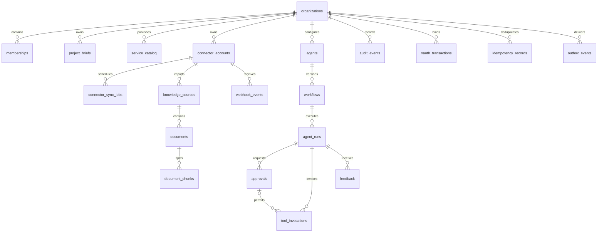

# Proposed PostgreSQL / Supabase model
Status SPECIFIED. schema-review.sql is a review draft ending in ROLLBACK. No database was contacted and no migration was applied. All 20 tables are in an unexposed private schema with forced RLS, no client grants and no permissive policies. This is intentionally fail-closed design, not a working backend.

All cross-resource relationships use (organization_id,id) composite references; UUID secrecy is not authorization. A later write procedure must also validate the referenced user is a current member and the approval belongs to the same run/action. Composite foreign keys establish tenant consistency but do not establish actor permissions.

## RLS/access plan
- Published service catalog: expose only an explicit public projection of approved fields, not private tenant service rows.
- Organizations/memberships: member can read own active membership and organization summary; only reviewed admin operations mutate roles. Bootstrap is privileged and audited. Avoid recursive membership policies: implement a narrowly scoped membership predicate with fixed search_path and dedicated function-owner role, or resolve access through the backend. Neither function nor grant is installed in this draft.
- Briefs, runs and feedback: actor sees own permitted rows; operator can see assigned organization scope, excluding restricted source text. All writes go through verified backend transactions.
- Sources/documents/chunks: tenant membership alone is insufficient. Intersect source ACL and current user/groups; deletion and revocation must invalidate retrieval, citations and caches. No broad org-wide SELECT policy is proposed for content.
- Connector credentials, OAuth state, sync jobs, webhook payloads, idempotency and outbox: backend only. Store vault/object references; encrypt sensitive payloads separately and keep access-scoped retrieval. Never store bearer secrets in readable tables.
- Approvals: assigned reviewer only; self-approval prohibited; immutable action hash plus expiry and expected version enforced in an atomic backend procedure. Run matching and single consumption require procedural checks before execution.
- Audit: application writer may INSERT redacted events only, no UPDATE/DELETE. Retention job under separate controlled role archives/deletes per agreed policy. Backups and access logs are part of deployment scope.

## Lifecycle and integrity
Workflow published versions are immutable. Run and approval state machines are enforced by transactional procedures not included in this design-only release. Unique action keys and provider event IDs support deduplication; the outbox row is inserted in the same transaction as the state change. Secrets are revoked before connector jobs are cancelled. Pseudonymize feedback and remove linked document payloads at retention expiry; preserve minimal legally approved audit metadata separately.

Embedding dimensions, distance metric, pgvector extension/index choice and capacity are TO_VERIFY against the selected embedding model and representative ACL-filtered workload. No fake fixed vector dimension is committed. Store model/version and regenerate embeddings on model change in a future migration. Retention_days is selected per organization; no default legal period is assumed.

## Before implementation
Provision isolated test database; choose region and backup policy; install verified auth roles; implement audited transition procedures and policies; execute schema migrations there; test cross-tenant joins, stale membership, source revocation, approval replay, concurrent retries, backup restore and retention. These are required stage-5 checks, not tests completed here.
