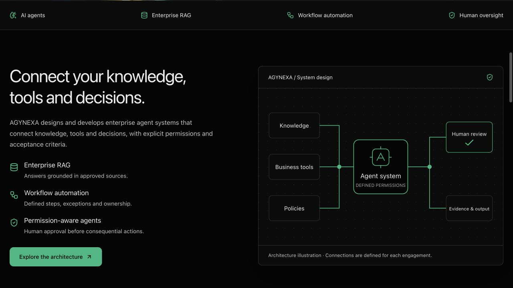

# فهرس الأدلة وحدودها

الأدلة هنا تربط التقرير ببيئة وإصدار. لقطات الشاشة لا تثبت وحدها تنفيذ backend، ونتائج قديمة لا تتحول إلى قياس للإصدار الجديد دون إعادة الفحص المناسب.

## إصدار المراحل 4–6

المصدر `991deca`، دمج الإنتاج `f6e92b3`، النشر `dpl_DDycdDNvYHZp831drKdsFuFsmMYP`، 19 أكتوبر 2026.

| الدليل | البيئة وما يثبته | الحدود |
|---|---|---|
| [نتائج الإنتاج](stages-4-6/production-verification.json) | 28 HTTP checks، 15 صفحة ممثلة، 64 URL في sitemap، فيديو يعمل، اختيار قطاع ومثال مشتريات | خلاصة محفوظة للفحص؛ ليست raw trace لكل خطوة |
| [Hero](stages-4-6/production-hero.png) | إنتاج، مظهر المقدمة بعد تصحيح overlay | إطار واحد من فيديو متحرك |
| [مكونات الرئيسية](stages-4-6/production-components.png) | إنتاج، رسم البنية وتقسيم المحتوى | لقطة viewport وليست كل الصفحة |
| [القطاعات](stages-4-6/production-industries.png) | إنتاج، اختيار التأمين ومحتواه | عينة قطاع واحدة |
| [مراجعة المشتريات](stages-4-6/production-procurement.png) | إنتاج، ناتج مثال افتراضي | لا شراء أو وصول مورد حقيقي |
| [Hero عربي 390px](stages-4-6/local-hero-ar-mobile.png) | localhost، عينة شاشة عربية ضيقة أثناء التحقق | ليست لقطة إنتاج؛ ليست كل المقاسات |
| [مشتريات عربي 390px](stages-4-6/local-procurement-ar-mobile.png) | localhost، عينة تدفق عربي ضيق أثناء التحقق | ليست لقطة إنتاج أو محاكاة جهاز حقيقي |
| [بصمات البداية](stages-4-6/hero-before.sha256) | مصدر الملفات المحمية | CSS المشترك يفحص بصريًا أيضًا |
| [design-detector](stages-4-6/design-detector.json) | مراجعة آلية مساعدة | ليست مراجعة مستقلة أو شهادة جودة؛ تحذير wordmark محفوظ |

اللقطات نُقلت كما هي من مخرجات المهمة إلى هذا المجلد حتى تعمل روابطها من GitHub. [manifest الصور](stages-4-6/assets-manifest.json) يحفظ الأحجام والبصمات وبيئة الالتقاط. لم تُعدّل الصور أو تُقدّم لقطات محلية على أنها إنتاج. لقطات القطاعات المحلية الأقدم، قبل تعديل النص المساعد، لم تُختَر كدليل نهائي هنا.

## الفحوص الفعلية

- build إنتاجي بما فيه TypeScript: ناجح قبل النشر.
- `tests/procurement.test.mjs`: 4 اختبارات ناجحة للمدخلات والحسابات.
- `tests/http-smoke.mjs`: 28 فحصًا ناجحًا محليًا وعلى الإنتاج؛ تشمل 15 صفحة ممثلة وحدود API و404 وsitemap/robots.
- المتصفح الإنتاجي: اختيار التأمين غيّر المحتوى؛ POST عربي أعاد `CLARIFICATION_REQUIRED` عند غياب الضمان؛ لم تُلتقط أخطاء console في التبويب المختبر.
- الفيديو في الإنتاج: `readyState=4`، `paused=false`، زمن مرصود 7.392593 ثانية.
- اللون المقاس للعنوان والعناصر المختبرة: `rgb(16,185,129)`؛ SDK Speed Insights 2.0.0 مرة واحدة.
- فحوص 390px كانت محلية. أداة viewport على الإنتاج بقيت 1280px. لا اختبار جميع المتصفحات أو audit وصول كامل أو حمل أو RLS.
- لم يُرسل بريد أثناء الاختبار ولم تحدث كتابة خارجية أو استدعاء نموذج مدفوع. صفر أخطاء مرصودة لا يعني خلو كل الموقع من الأخطاء.

## حماية الفيديو والمقدمة

| الملف | SHA-256 |
|---|---|
| `public/videos/background.mp4` | `b12fece112afbb09094f352fe152bb8ada1485527f84f5abad5f9b8af32abf85` |
| `@components/landing-5-hero-video.tsx` | `e48e61612000df149fadf6e96dc0e03bca1affa9bf40841a2c8f3ff00a61ccca` |
| `@components/landing-5-hero-section.tsx` | `0e627aca93d1a514f2cc6cbf17db91241ab7c04abdabe8fa5dba490185e043c1` |

الفيديو 9,885,990 بايت. ملفات المقدمة الثلاثة ثابتة؛ CSS وShell تغيرا ضمن النطاق. مطابقة الملف المنشور بايتًا للبايت كانت مثبتة في الإصدار السابق [final-video-verification](final-video-verification.json)؛ أحدث إصدار تحقق من ثبات المصدر وتشغيل الفيديو ولم يُعد تنزيله كاملًا. [baseline الكامل](../baseline/hero-protection.json) يصف أيضًا الملفات المشتركة وقت البداية، ولا يعني أنها جميعًا ظلت ثابتة.

## أدلة سابقة

- [تسليم 1–3](../releases/STAGES-1-3-DELIVERY.md) و[HTTP الإنتاج حينها](production-stage-1-3-checks.json).
- [مراجعة Humanizer](humanizer-review.json) و[قياس ألوان المرجع](official-brand-measurements.json).
- [تقرير Speed Insights](../releases/SPEED-INSIGHTS-VERIFICATION.md) و[لقطة لوحة القياس](speed-insights-production.png): 3 أحداث وRES 100 وقت الفحص؛ عينة صغيرة وليست تقييم الأداء الحالي.
- [تثبيت المصدر](../source-map.json) و[baseline UI](live-baseline.json).

لا تعِد الزحف المرجعي أو تشغيل الفحوص لمجرد تحديث وصف دليل. عند تغير الكود أو ظهور مشكلة، افحص المسار المتأثر وسجّل الإصدار الجديد.

## إصلاحات المرحلة 4 — مرشح محلي 19 أكتوبر 2026

[الدليل ولقطات الكمبيوتر والجوال](visual-repair-2026-10-19/README.md)، مصدر المنتج `dc62aacae12373d7ce80c4c5f2c9b62510db3a9b`. هذه لقطات بناء محلي وليست الإنتاج.

## إنتاج 20 أكتوبر 2026

[نتائج 390px](stage4-production-2026-10-20/verification.json) و[حالة الوصول إلى Supabase](stage4-production-2026-10-20/supabase-access.json). المنتج نُشر؛ الاتصال بقاعدة المشروع الجديد لم يُثبت.

[اختبار اتصال Supabase](supabase-connection-2026-10-20/verification.json): حساب agynexa والمشروع المحدد فقط؛ لا أسرار أو بيانات عملاء في الدليل.
