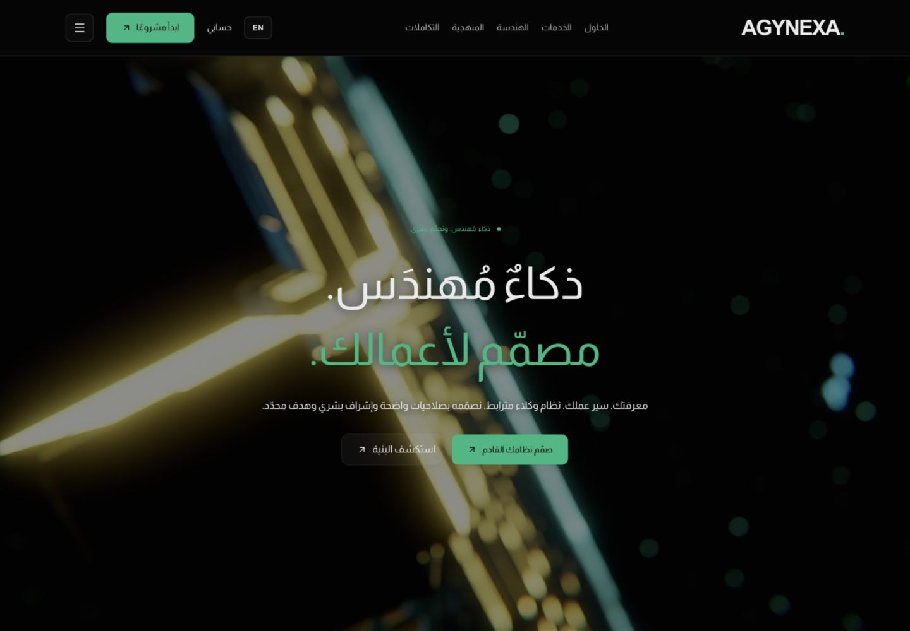

# نشر تحسين الواجهة ومتابعة الحسابات — 20 أكتوبر 2026

## النطاق والقرار

طلب المالك «سيب البريد دلوقتي وكمل الشغل» بعد ترتيب النشر ثم الحسابات. أُجّل البريد وSMTP واستعادة الحساب؛ ذكر Spacemail سابقًا لم يكن تفويضًا لربط صندوق المالك. استُكمل نشر الواجهة ثم إصلاح محدد لتصنيف أخطاء الحسابات. لا migrations أو تغيير إعدادات Auth أو بريد أو مستخدمين جدد.

مراجعة السوق سبق أن قُرئت كاملة وطُوبقت في [نطاق الواجهة](../reviews/VISUAL-UPGRADE-SCOPE-2026-10-20.md). هذه المتابعة تحسن وضوح حالة الخدمة، مع حفظ الهوية والخدمات والمحتوى؛ لا تعتمد تحول RFQ ولا تدعي تنفيذ بوابة العملاء أو التكاملات.

## الواجهة المنشورة

دُمج [PR #30](https://github.com/adham-younes/vzero/pull/30) عند `2ddd0c9bc846215f892b512308679d6e93b1da81`. نشر `dpl_CpJ76M8jnckdXTAGWbtX2cjubRsJ` جاهز وإنتاجي، وalias `vzero-nine-beryl.vercel.app` مرتبط به. كود الواجهة `5ade5f2`؛ لا تغيير لملف الفيديو أو مكوني Hero.

تحقق المتصفح الجانبي من الرئيسية العربية عند 1440، والفيديو autoplay/muted/loop مع controls=false وpaused=false، وزمن تشغيل متغير دون زر. نجح مسار بدء المشروع، والتحقق من خمسة حقول ناقصة مع تركيز المؤسسة، والتبديل إلى الإنجليزية مع حفظ `/start`. الحساب دون جلسة يعرض نموذج الدخول المتوقع. لا تدعي هذه العينة اكتمال رحلة حساب مصادق عليها.

## إصلاح تصنيف الأخطاء

كود المنتج `94db39e`: `signedIn()` وlogin كانا يحولان جميع أخطاء Supabase المهيكلة إلى 401. اختبار معالجات التطبيق الفعلية بحد خارجي محاكى أثبت أن انقطاع الشبكة و503 و429 تتحول إلى رفض جلسة/كلمة مرور. الإصلاح يرجع 503 `temporarily_unavailable` لأخطاء الاتصال/الخادم/الأخطاء غير المعروفة، و429 `try_later` لحد المحاولات؛ رفض المصادقة الحقيقي يبقى 401. لا بيانات مزود أو أسرار في الاستجابة، ولا إعادة محاولة آلية أو تغيير سياسة الجلسة.

التحقق: 4 حالات فشلت قبل الإصلاح (401 بدل 503/429)، ثم نجحت 10 اختبارات شملت اختبارات المدخلات الموجودة؛ build وTypeScript نجحا. ظهر تحذير Node المعروف MODULE_TYPELESS_PACKAGE_JSON في اختبارات TypeScript؛ لا تغيير حزم أو إعدادات لإخفائه. الاختبارات لا تتصل بـSupabase ولا تنشئ حسابات. فحص سجلات Vercel الإنتاجية 503 خلال 24 ساعة أعاد صفر سجلات؛ هذا ليس إثبات غياب التقطع أو سببه.

مرجع القرار: [أنواع أخطاء Supabase](https://supabase.com/docs/guides/auth/debugging/error-codes). روجع changelog؛ [تغيير TLS المعلن](https://supabase.com/changelog/cbc-tls-ciphers-deprecated) يبدأ 10 نوفمبر على أقرب تقدير ولا يفسر هذا التحويل البرمجي.

سبب 401/login503 التاريخي غير مثبت. الإصلاح يزيل خلطًا مثبتًا في تصنيف الأخطاء، ولا يثبت زوال جميع الأعطال المتقطعة. رحلة المحادثة المصادق عليها لم تُعد لعدم وجود جلسة دخول نشطة في المتصفح المستخدم؛ لا تُنشأ حسابات إنتاجية للاختبار.

## المتبقي

البريد والاستعادة مؤجلان بطلب المالك. تتبّع أي تكرار بأدلة وقت/مسار منقحة. بوابة العملاء (مراحل وملفات وموافقات) والتكاملات والفوترة ما زالت غير منفذة ضمن هذا النطاق.
