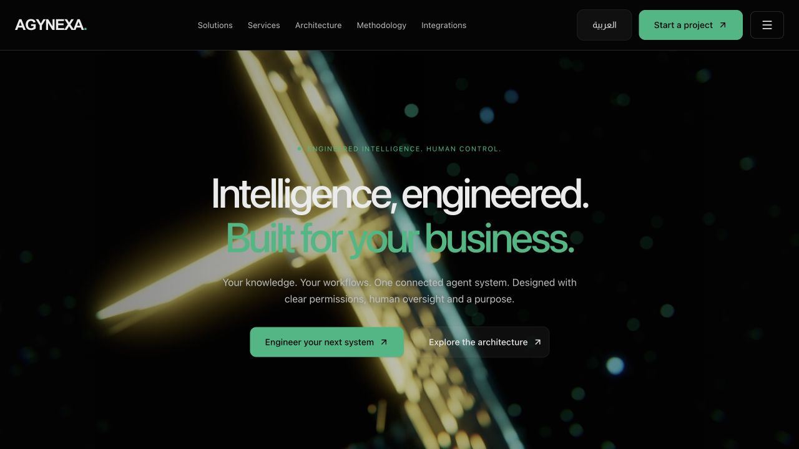
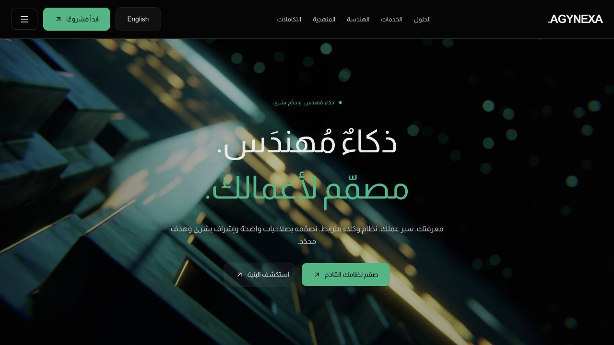

# المرحلة 0 — تثبيت المصدر وحماية AGYNEXA

التاريخ: 19 أكتوبر 2026، بتوقيت القاهرة. الحالة: مكتملة مع نقاط غير محسومة موثقة؛ بانتظار مراجعة المالك قبل المرحلة 1.

## ما تم تثبيته

- المستودع: [adham-younes/vzero](https://github.com/adham-younes/vzero).
- نسخة المصدر: `a4a8a5daf00c36074f9db0e43184fe84d64a9f7a`؛ كانت مطابقة لـGitHub main وقت التحقق.
- فرع العمل المحلي: `codex/agynexa-stage-0` داخل نسخة منفصلة خاصة بهذه المهمة.
- مشروع Vercel: `vzero` ضمن `adhamlouxors-projects`؛ اتصال المستودع وفرع الإنتاج `main` تأكدا من لوحة Vercel قراءةً فقط.
- النشر الموجود: `dpl_2BgMXxiePrvjPQjsnLrWZiDrzmmz`، حالته Ready وبيئته Production.
- [الموقع الموجود](https://vzero-nine-beryl.vercel.app/) مستخدم كمرجع؛ ليس Preview جديدًا من هذه المرحلة. لم يتم إنشاء localhost لأن المرحلة توثيق فقط.

## حماية الـHero

الفيديو `public/videos/background.mp4` حجمه **9,885,990 بايت**، وبصمته:

`b12fece112afbb09094f352fe152bb8ada1485527f84f5abad5f9b8af32abf85`

بصمة الملف المنشور مطابقة للملف المحلي. الفيديو عُرض بدقة 2560×1440 ومدته 10.01 ثانية، وحالة readyState=4 وpaused=false وerror=null. لقطتا الزمن اختلفتا أثناء الدوران. هذه أدلة على التشغيل الحالي؛ المقارنة البصرية اللاحقة تحتاج مراعاة اختلاف إطار الفيديو المتحرك.

تم حفظ لقطات الـHero بالإنجليزي والعربي عند 1280×720، وقياس الألوان من المتصفح. لم تُلتقط baseline للهاتف في هذه المرحلة. ملفات الـHero المباشرة وبقية اعتماداتها المشتركة مسجلة في `baseline/hero-protection.json`.

## خريطة الكود والهوية

- 17 مسار صفحة من المصدر: الرئيسية، 10 صفحات رئيسية أخرى، و6 حلول. القائمة في `routes.json`.
- محتوى الحلول موجود في `lib/agynexa.ts`؛ العرض في `@components/agynexa-pages.tsx`؛ التوجيه في `app/[...path]/page.tsx`.
- التحويل اللغوي في `agynexa-shell.tsx` ويغيّر lang/dir في المتصفح؛ لا مسارات لغوية منفصلة حاليًا.
- لا app/api أو اتصال قاعدة بيانات ضمن المصدر المفحوص. موجز المشروع ومساحة الوكيل واجهات محلية حسب الكود.
- قيم التصميم الفعلية محفوظة في `brand-lock.json` و`BRAND-LOCK.md`. الأسود `#050505` والأخضر `#10B981` مؤكدان من المصدر والمتصفح.
- مصفوفة الأدوات تميّز ما اختُبر عمّا هو ظاهر فقط؛ لم تُثبّت أدوات أو تُرسل طلبات توليد مدفوعة.

## حدود الدليل

1. **UNKNOWN:** صفحة النشر القديم لا تعرض Git SHA؛ لا يوجد إثبات أنه بُني من commit المصدر الحالي. اتصال المستودع ومطابقة الفيديو لا يثبتان تطابق كل ملفات النشر.
2. **UNKNOWN:** نسخة المحتوى القديمة للمشتريات والتحصيل خارج المستودع الحالي لم تُحدد. الموجود حاليًا يتضمن أوامر شراء ضمن حل المالية.
3. **BLOCKED سابقًا:** موصّل Vercel أعاد 404؛ فحص المتصفح نجح. لم تُغيّر حماية أو صلاحيات لمعالجة ذلك.
4. نتيجة Better Design عن وضع فاتح/داكن تعارض القواعد النهائية؛ تم اعتماد CSS الفعلي والقيم المحسوبة، ولم تُطبق توصية توليد theme.

## التغييرات والفحوص

الإضافات كلها تحت `docs/agynexa-program/`: الخطة المعتمدة، Source Map، Brand Lock، جرد المحتوى والمسارات والتبعيات والأدوات، البصمات، الأدلة، STATUS وRESUME وهذا التقرير. كود المنتج والـHero والفيديو والإنتاج وقواعد البيانات والإعدادات لم تُعدّل. لا push ولا نشر.

الفحوص المنفذة: نظافة البداية، مقارنة البصمات السابقة، تثبيت remote main، قراءة ربط Vercel والفرع، قياس UI والتقاط اللقطات، مقارنة SHA-256 للفيديو المنشور، وفحص عدم وجود diff في ملفات المنتج. لم يُشغّل build أو lint أو typecheck أو اختبارات API؛ هذه مرحلة توثيق وفق السياسة الاقتصادية المعتمدة.

مرجع commit لهذه الحزمة يُستخرج بعد تسجيلها محليًا بالأمر:
`git log -1 --format=%H -- docs/agynexa-program/releases/STAGE-0.md`

## الخطوة التالية

بعد اعتماد المالك: المرحلة 1 فقط، باستكمال تحليل Kore.ai ووثائقه من الأدلة المحفوظة، مع INFERRED وUNKNOWN عند غياب الإثبات. لا يبدأ تطوير الصفحات أو APIs في هذه الخطوة.
