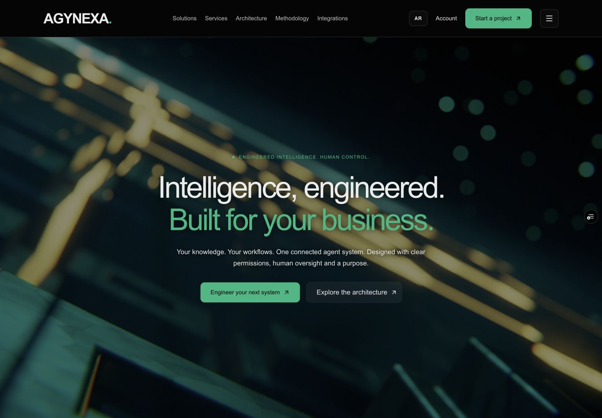
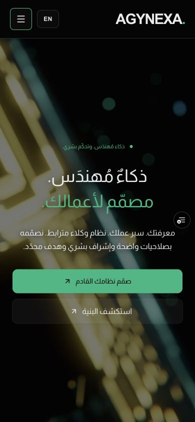

# تحسين الواجهة الثنائية — 20 أكتوبر 2026

مرشح مراجعة في [PR #30](https://github.com/adham-younes/vzero/pull/30)، أساسه `main@063fc2e`. آخر كود منتج `5ade5f2cfefff3370721cacd3ab3ec80eec5756d`. النشر الإنتاجي لم يتغير ضمن هذا التسليم.

## النتيجة

- اسم AGYNEXA من 24px إلى 34px على الكمبيوتر و29px على الهاتف، مع اتجاه ثابت LTR للاسم والنقطة.
- تبديل لغة مختصر AR/EN، عنصر مرئي 44×36px مع مساحة لمس ممتدة؛ يحفظ الصفحة وquery وhash. قائمة مجمعة وإجراء بدء مشروع بارز، وروابط الحساب وStudio، وإغلاق Escape يعيد التركيز.
- خط إنجليزي مشترك وAlmarai للعربية، نص أساسي وثانوي من tokens، قياسات حقول وأزرار متسقة وهوامش مشتركة وbreadcrumbs مرتبطة.
- تعتيم CSS خلف النص 46% للكمبيوتر و55% للهاتف. الفيديو الأصلي ومكونا Hero محفوظة بالبصمة؛ تشغيل تلقائي muted/loop/playsInline دون أي زر تشغيل أو إيقاف، وفق تصحيح المالك الأحدث.
- شرح عملي بعد المقدمة، رابط مبكر للمثال في حل المشتريات، لون تحذير دلالي للنواقص مع بقاء الأخضر للهوية.
- حقول مطلوبة واضحة وأمثلة، مساعدة اختيارية لتحديد المصادر والنجاح، تحقق بريدي وأخطاء داخلية، مراجعة الموجز كحقول معنونة، وتوضيح الحفظ والتنزيل والبريد اليدوي. تعديل الموجز يحفظ المدخلات والموافقة تعاد لكل مراجعة.
- إظهار/إخفاء كلمة المرور، وتسمية تفاصيل مصادر الموجز ومعيار نجاحه في الحساب. لا تغيير للمصادقة أو التخزين.
- مثال AgentNexOS موسوم ببيانات افتراضية: مهمة ثم مراجعة ثم مخرج، مع رابط إلى Studio الحالي. لا يدعي إدارة مشروعات عملاء أو تنفيذ شراء.

## التحقق

بناء إنتاجي محلي وTypeScript ناجحان؛ أُعيد البناء مرة بعد التصحيح الصريح الخاص بالفيديو. فحص متصفح جانبي فعلي لعينة عربية/إنجليزية عند 320 و390 و768 و1440 بكسل. تحقق التفاعل من التبديل وحفظ anchor، القائمة وEscape، أخطاء الحقول والبريد، طلب المساعدة، مراجعة وتعديل الموجز وبوابة الموافقة، مقارنة الموردين، وإظهار كلمة المرور. عينات الأحجام لا تعني تدقيق كل جهاز أو شهادة وصول.

[الإيصال المقروء آليًا](../evidence/visual-upgrade-2026-10-20/verification.json). صور الصفحات غير الرئيسية التقطت من أول بناء لهذا التغيير؛ التصحيح اللاحق أزال أزرار الفيديو وضبط ارتفاع التحكم وإخفاء skip خارج التركيز. لقطات الرئيسية النهائية تستبدل صور الأزرار الملغاة. لا حسابات اختبار أو إرسال بريد أو كتابة بيانات إنتاجية. لا إعادة تشغيل لحزم API التي لم تتغير.

## المعاينة النهائية

[نسخة Vercel المفحوصة](https://vzero-acnado0le-adhamlouxors-projects.vercel.app/ar) حالتها Ready، ومعرّفها `dpl_4UMNzExRLCbM9AqaWDmXShcybCLh` على كود المنتج `5ade5f2`. تحقق المتصفح الجانبي من autoplay وmuted وloop، مع controls=false وpaused=false؛ زاد زمن التشغيل من 5.57 إلى 9.70 ثانية دون ضغط تشغيل. لا أزرار مخصصة لتشغيل/إيقاف الفيديو. لا تجاوز أفقي في الرئيسية العربية 390 والإنجليزية 1440. الأيقونة الجانبية في المعاينة تخص Vercel Live Feedback وليست تحكمًا في فيديو المنصة.

## أثر مراجعة السوق والحدود

[قراءة ومطابقة النطاق](../reviews/VISUAL-UPGRADE-SCOPE-2026-10-20.md) تمت قبل التنفيذ. حُفظت الخدمات العشر والحلول التسعة والمحتوى الأصلي ومساراتها؛ API وDB دون تغيير. لم تستدعَ موصلات توليد أو أصول مدفوعة.

حدد المالك `adham@agynexa.si` على Spacemail / Spaceship لاستعادة الحساب. بيانات SMTP وقناة حفظها والتحقق من ملكية البريد لم تتوفر في هذا التسليم؛ الاستعادة لم تنفذ ولم يرسل بريد. مشروع تسليم العملاء الكامل (مراحل/ملفات/موافقات فريق) يحتاج عقد بيانات ونطاق مستقل؛ الموجود موجزات محفوظة وStudio المحدود.

التراجع بعد نشر مفوض: revert كود المنتج دون migrations؛ يبقى الفيديو والمخطط والحسابات كما هي. الدمج والنشر الإنتاجي يتبعان قرار المالك النهائي في WORKFLOW.
