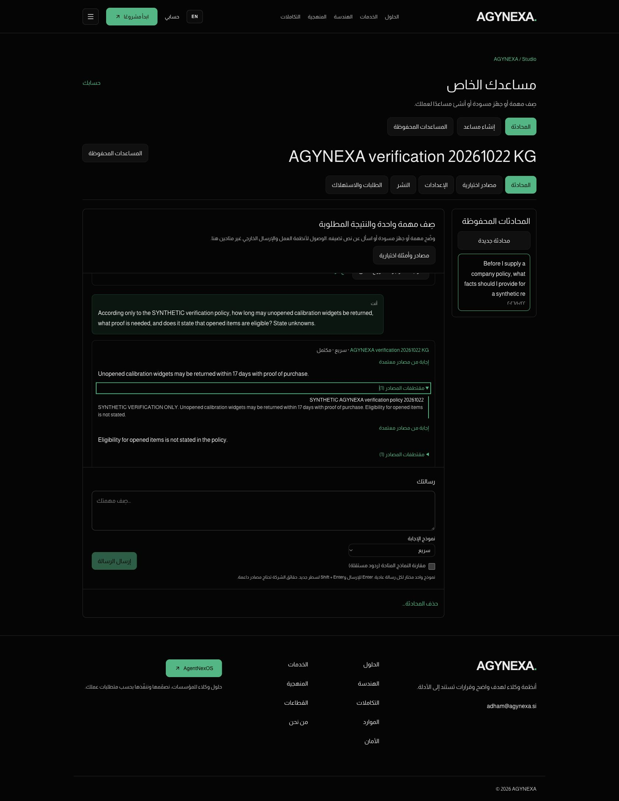
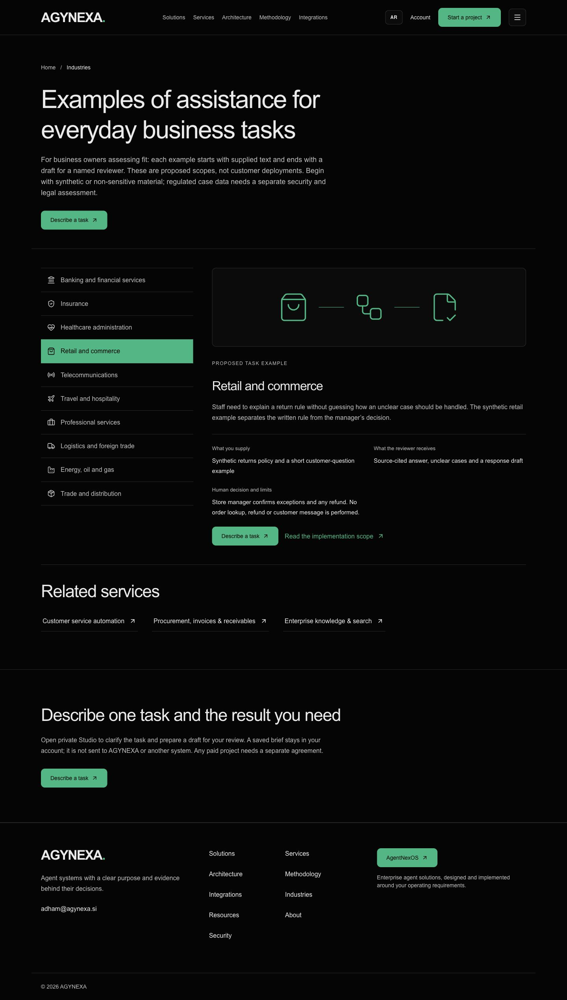
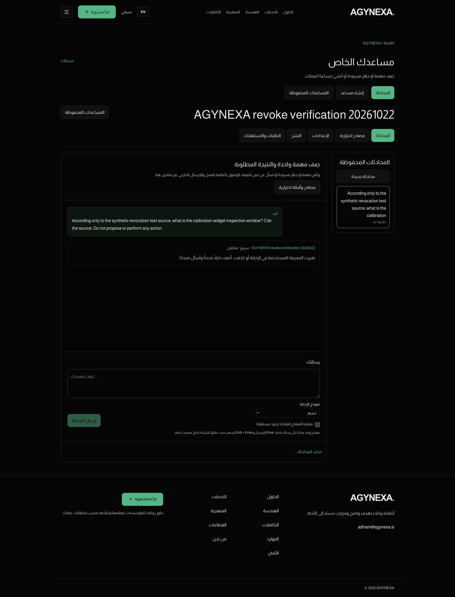

# AGYNEXA completion audit — 22 October 2026

**Current publication:** approved identity/contact/GSC released via [PR39](https://github.com/adham-younes/vzero/pull/39), main`87db497`, READY`dpl_6VdmnbeS9PVmW2wELztMtQYZUJUg`. Four affected public routes, exact Google53bytes/SHA and four representative browser samples PASS. [Release evidence](OWNER-IDENTITY-RELEASE.md). Earlier PR35/38 and local-only statements below are dated historical receipts; operating/legal/human decisions remain open.

**Final focused continuation:** [PR38](https://github.com/adham-younes/vzero/pull/38) merges the context-specific private UI recovery after the missing local acceptance cases and narrowly scoped fixes. All four actual semantic responses and original failures remain intact; model-authored next guidance is PARTIAL, while the actual captured missing-evidence state now has a deterministic UI route to the existing approved-source editor. [Full continuation](REMAINING-ACCEPTANCE.md), [14 captured render/wiring checks](evidence/remaining-acceptance/recovery-ui.json), [exact safe live trace](evidence/remaining-acceptance/semantic-final-live.json), [fixture cleanup](evidence/remaining-acceptance/semantic-fixture-cleanup.json). Final primary`ceeb7af` / `dpl_99qSVUnJQ3V5mQmzHAt9nPZXW5Lb` READY, alias source/health200/all3ok and delivered component JS PASS: [receipt](evidence/remaining-acceptance/final-deployment.json). Human comprehension/legal/commercial/retention/recovery gates remain open. Earlier no-restart/adversarial-missing statements below describe the prior audit and are superseded by this dated continuation. No completion percentage is inferred.

**Verdict:** the selected bounded implementation is deployed and its main customer paths have substantial real evidence. The full accepted plan is **not wholly verified or commercially launch-ready**. Current evidence now includes authenticated production intake chat/history and a genuinely newly built KnowledgeGrid's source-free chat, private ingestion, original citations and contextual follow-up. Production user-facing source deletion/history revocation has now passed its narrow live check. Explicit reader comprehension and several adversarial/edge cases remain open. No completion percentage is inferred from test counts.

Audit base: main `4638222e242aa48d6294b03bdf5e6bfc37b2f093`, primary READY `dpl_6WeX6HCpMuikAADR77Vbm7vm7D5e`. Fresh Git remote and Vercel alias/source metadata matched. Permission-copy correction PR35 is now deployed: main`fcd6175efb0f263265d97b5df76774ee268fdac4`, READY`dpl_34SMMUzto7t64wK5UswKp6Xp8Gkc`; final health200/all3 checksok. The full original plan/spec/addendum/research remain untouched, not replaced by this matrix.

## Basis and newer overrides

Read the full [implementation plan](implementation-plan.md), [product spec](product-spec.md), [builder study](agent-builder-options.md), [architecture review](architecture-review.md), [coordinator addendum](coordinator-review-addendum.md), current status/ledger and named evidence. Later owner overrides expose all3 models with supported ceilings, remove artificial response/character limits, approve phased production delivery, and leave retention/recovery/legal/commercial facts unapproved. Optional Linux/email/arbitrary-tools/BYOK/framework transplant are not selected first-release requirements.

`VERIFIED` below always means the stated environment and representative cases. `PARTIAL/WEAK/MISSING_EVIDENCE` does not assert a defect. `INCOMPLETE/OWNER_DECISION` identifies an unfinished acceptance requirement or real operating decision. A source check, local deterministic-model journey and actual production model/browser journey are not interchangeable.

## Current live journey and independent review

1. **Existing authorized session — healthy.** Historical audit tab1780151779 was absent; dedicated Chrome audit1780152269 was already signed in. No credentials, cookies, account settings or unrelated tabs were accessed.
2. **Default intake chat/history — PASS.** One generic synthetic retail question returned useful clarification on Fast, without invented company facts or external action. Refresh restored the exact full turn/history. This is stronger than prior separate local-browser/provider smoke evidence.
3. **New private KnowledgeGrid — PASS for creation and own chat.** Explicit reviewed builder produced a distinct saved identity/settings URL. Exact-new-object hosted metadata independently established `template=knowledgegrid`, `chat_profile=customer_v1`, `model=openai/gpt-oss-20b`; it was not just the default guide or a legacy strict agent.
4. **No-file utility, approved text and follow-up — PASS.** Before any source, the newKG clarified useful inputs. Explicit private156-byte synthetic policy/public approvalOFF then produced the exact17-day/proof-of-purchase answer, opened-item UNKNOWN, original excerpt and grounded follow-up. Three live model calls, plus the one intake call; no diagnostic extra generation.
5. **Source delete/history revocation — PASS after bounded recovery.** Initial native-confirm/focus failure and ready-source state remain recorded in the first trace; one same-tab reacquisition restored control. A fresh minimal privateKG/source then used onlyONE cited19-day answer. The source was deleted through the actual UI confirmation. Hard refresh of the same history retained the user's question but replaced generated facts/citations with the knowledge-changed notice; composer enabled. Exact-new-object hosted state independently showed source statusdeleted, publicOFF,0chunks and1run before cleanup. No intro/follow-up/other-model/security suite was repeated. Total5 new live model turns in this audit.
6. **Fixture cleanup — PASS, separate from UI proof.** Guarded exact-ID/name/template/profile/model/creation-time/no-publication transactions removed only the two new disposableKG assistants and their descendants. Across them:2synthetic sources,2chunks,4runs,0proposals; the one exact synthetic intake turn was also removed. Zero descendants verified for each fixture. Pre-existing assistant/account/settings were retained. Raw identifiers remainprivate0600. Cleanup does not substitute for step5.
7. **Independent visual sample — healthy within scope.** The lead, independent of UI/content authorship, inspected supplied ENStudio1440/builder768/ARStudio390 and new live service390, solution390, industries retail390/1440. Branding/controls/hierarchy remain coherent and the4 public captures had scrollWidth equal viewport. No material visible overflow or layout defect found in those samples. Screenshots do not establish keyboard/screen-reader/contrast conformance or every affected route/variant. Saved history can correctly retain English user text in Arabic UI.

The screenshot set contains only generic/synthetic audit content and the site's already-public footer contact. No account email, personal agent/source title, unrelated conversation, token or private object UUID is published. Exact cleanup identifiers remain mode0600 under private `work/`, outside the repository/output bundle. No fresh capture of owner-added content was made.

[Current session evidence](evidence/completion-audit/production-session-audit.json) · [NewKG live trace](evidence/completion-audit/production-builder-e2e.json) · [Hosted metadata/cleanup](evidence/completion-audit/audit-hosted-metadata.json).

## Requirement matrix

Evidence references below name exact repository files/test checks, not new executions. The matrix covers all24 original acceptance rows plus the selected builder and newer owner constraints/launch decisions. Full JSON: [completion-matrix.json](evidence/completion-audit/completion-matrix.json).

| ID | Requirement | Implementation / coverage | Existing evidence and precise limit |
|---|---|---|---|
| A1 | Source-free customer entry | IMPLEMENTED / **VERIFIED** | security checks10–12; browser group1; live intake chat/history. Live intake uses one existing signed-in account; new-account email/recovery is separate. |
| A2 | Existing personal assistants preserved | IMPLEMENTED / **VERIFIED** | security checks3–5; source diff/home protections. Local original instructions/profile unchanged; no production personal data inspected. |
| A3 | Concurrent bootstrap, collision and input guards | IMPLEMENTED / **VERIFIED_FOCUSED_LOCAL** | security4/6/8 + remaining-acceptance/http.json. Reserved profile/template collisions and invalid locale types reject; valid Arabic existing-bootstrap preserves identity/language. Representative cases, not all possible race schedules. |
| A4 | Localized auth intent and safe return URLs | IMPLEMENTED / **VERIFIED_FOCUSED_LOCAL** | remaining-acceptance/pure.json and ui.json verifiedUnion. Unsafe/external/scheme-relative/backslash/encoded returns reject; actual Account/Start auth intent and mounted draft/no autosave pass. No new production account/recovery claim. |
| A5 | Complete private conversation scope and pagination | IMPLEMENTED / **VERIFIED** | security checks7,18,35–36; transitive.json; output-capacity.cjs; live history. Real Auth/DB scope checks plus current live persisted turn; long pagination byte bounds covered synthetically, not giant paid output. |
| A6 | EN/AR follow-up from full turns/current evidence | IMPLEMENTED / **VERIFIED** | security check17; browser group4; launch-contract.cjs. Representative English/Arabic follow-ups passed with deterministic local model; general multilingual understanding is not established. |
| A7 | Mixed-script lexical normalization | IMPLEMENTED / **VERIFIED** | security checks15–17; launch-contract.cjs. Original وTypeScript preserved and query matches; no semantic/vector/translation claim. |
| A8 | Discovery vs unsupported company facts | IMPLEMENTED / **VERIFIED** | provider-access.json9 samples; live intake; security10–12; actual newKG source-free+cited/unknown trace. Nine tiny live samples plus actual intake result; not a general hallucination guarantee. |
| A9 | Mixed sourced fact/draft and semantic entailment | IMPLEMENTED / **VERIFIED_REPRESENTATIVE_AND_ACTUAL_PRIVATE_UI_RECOVERY** | remaining-acceptance/semantic-final-live.json,recovery-ui.json,recovery-production-asset.json,recovery-production-click.json. Prior adversarial model-authored guidance remains partial, with correct representative grounding/nondisclosure. Deterministic private recovery now actually clicked once in production after one synthetic Fast turn: existing Optional sources form, empty fields,public approvalOFF,sources0,Add source disabled. Hosted guards confirmed1validated succeeded actor-bound Studio missing-evidence run/0sources/proposals/publications/keys; exactfixture removed/all8remaining0. New owned tab closed, no active live handle. No universal semantic guarantee. |
| A10 | Revocation across history/replay/activity/derived output | IMPLEMENTED / **VERIFIED_LOCAL_AND_LIVE_REPRESENTATIVE** | security24–28; transitive.json; browser group6; production-revocation-e2e.json. Actual production UI deletion plus refreshed existing-history factual/citation redaction passed on the fresh minimal fixture. Local tests separately cover replay/activity/transitive/race/grant invariants. Initial tool failure remains recorded; later cleanup is not substituted for this UI proof. |
| A11 | Source/cancel races and safe late completion | IMPLEMENTED / **VERIFIED** | security22–25; SQL finalizer under shared agent lock. Real DB transaction/race invariant checked with synthetic completion. Live in-flight provider cancellation was not repeated. |
| A12 | Public/private/API profile boundary | IMPLEMENTED / **VERIFIED** | security31–34; runtime.ts55; production-database.json. Real local widget and explicit profile rejection; hosted raw-run/proposal read grants closed. Not a fresh live published-widget suite. |
| A13 | Prompt injection/private-prompt extraction | IMPLEMENTED / **VERIFIED_LIVE_REPRESENTATIVE** | remaining-acceptance/semantic-final-live.json and semantic-fixture-cleanup.json. One injected private292-byte synthetic source/nonsecret fixture canary,4actual Fast turns: no canary disclosure/no asserted77-day policy/no external action. Source instruction remains quoted data. Representative evidence, not general injection immunity; exact fixture removed/allremaining0. |
| A14 | Exact replay identity/idempotency | IMPLEMENTED / **VERIFIED_FOCUSED_LOCAL** | security19–21; legacy replay; remaining-acceptance/http.json and ui.json. Same key binds actor/conversation; different access-kind gets distinct run. Ambiguous committed browser response exact retry persists one run. |
| A15 | Limits, timeout/429/cancel and error preservation | IMPLEMENTED / **VERIFIED_FOCUSED_LOCAL** | remaining-acceptance/pure.json,http.json,input-after-fix.json,ui.json; output-capacity.cjs. Three optional-input defects fixed;18 affected input cases pass. Controlled429/TimeoutError/cancel/uncertain response preserve text/no accepted failed answer. Synthetic transport; no real outage, wall-clock host deadline or paid maximum-generation claim. |
| A16 | Exact internal approval and expiry | IMPLEMENTED / **VERIFIED_FOCUSED_LOCAL** | security20–25; browser5; remaining-acceptance/http.json. Real decision transaction: controlled expiry,rejected/approved same-decision duplicate/conflicting decision. Expiry advanced only on isolated synthetic row; no15-minute wait or external sending. |
| A17 | Consent/private-save/manual export handoff | IMPLEMENTED / **VERIFIED_FOCUSED_LOCAL** | remaining-acceptance/ui.json verifiedUnion. Actual UTF8 TXT bytes contain every reviewed field. Mounted inline auth no autosave; response aborted after real brief commit then same key retries to exactly one brief. Manual email not sent. |
| A18 | Scoped deletion and approved retention | PARTIAL_POLICY_DEFERRED / **PARTIAL** | security35–38; migration nullable expiry; RELEASE-CONTROLS.md. Scoped conversation deletion passed. No retention policy approved, therefore no90-day timer/cron/purge. This is a deferred policy, not verified automatic deletion. |
| A19 | Two synthetic demonstrations | IMPLEMENTED / **VERIFIED_FOCUSED_LOCAL** | browser4 retail; remaining-acceptance/ui.json distribution. Distribution inspect→explicit private ingestion→original cited D104 two-day supplied delay; promised date/carrier/named owner unknown and manual decision. Deterministic local provider, no business integration. |
| A20 | Buyer comprehension and EN/AR factual parity | IMPLEMENTED_COPY / **INCOMPLETE_HUMAN_REVIEW_PREPARED** | HUMAN-COMPREHENSION-REVIEW.md; recovery UI addendum. Six bilingual real surface groups/30blank answers prepared including new contextual source recovery. NOT_YET_REVIEWED_BY_HUMAN; structural/model review cannot close it. |
| A21 | Four real reviewed legal pages | IMPLEMENTED_OPERATIONAL_NOTICES_FOUNDER_CONTACT_PUBLISHED / **PARTIAL_LEGAL_REVIEW_OWNER_DECISION** | legal-content.ts; OWNER-IDENTITY-RELEASE.md; evidence/owner-identity-production/http.json. Official founder/CEO/full name/email/phone and bilingual About/Contact identity now published/live verified via PR39. Registration incomplete per owner; no legal-registration assertion. Controller/jurisdiction/processing text and legal-page approval remain unanswered; contact display is not email-delivery verification. |
| A22 | Protected whole home/Hero/video | IMPLEMENTED_PROTECTION / **VERIFIED** | copy8 groups; home-comparison.json; production.json home6. Source/dependency protection and6 EN/AR390/768/1440 live matches; no global theme/home change. |
| A23 | Real isolated compatible environment/resources | IMPLEMENTED / **VERIFIED** | environment/security38; remaining-acceptance local build/HTTP/UI; resource receipt. Minimal real isolated stack restarted once for explicitly authorized missing cases, then all4containers/Next/dedicated VM stopped. Retained volumes are local synthetic fixtures; no running2GiB guest. |
| A24 | Existing envelope/strict agents/Compare compatibility | IMPLEMENTED / **VERIFIED_FOCUSED_LOCAL** | legacy replay; remaining-acceptance/http.json and ui.json. Explicit Compare executes3distinctmodels/IDs in one conversation; published strict API keeps existing{run} and immutable version/no customer chat metadata. Local synthetic publication/key revoked/unpublished; no new production key. |
| B1 | Builder creates a distinct customer-owned saved instance | IMPLEMENTED / **VERIFIED_LOCAL_AND_PRODUCTION** | browser group3 + production-builder-e2e.json + audit-hosted-metadata.json. Local newServiceFlow and actual newKnowledgeGrid creation/own-chat paths established. Production exact saved-profile independently verified; UI deletion/revocation still separate. |
| B2 | New KnowledgeGrid source-free chat then sourced answer | IMPLEMENTED / **VERIFIED_PRODUCTION_REPRESENTATIVE** | production-builder-e2e.json checks1–5; hosted template/profile/model metadata. NewKG/customer_v1/Fast: useful before-file clarification, explicit private156-byte source, exact17-day/proof citation and missing opened-item case, follow-up. Three live turns; no general semantic guarantee. |
| B3 | Review permissions match selected template | FIXED_DEPLOYED / **VERIFIED_PRODUCTION** | PR35/sourcefcd6175; production-revocation-e2e.json copy branches; permissions-fix-release.json. Actual Arabic KG summary excludes internal requests; SF requires explicit approval. English literals source-reviewed/buildpassed. Server permissions unchanged. |
| B4 | Describe/review/create/test/hosted delivery boundaries | IMPLEMENTED_BOUNDED_VERSION / **VERIFIED_LOCAL_AND_PARTIAL_LIVE** | studio.tsx AgentForm; browser group3; live review screenshot. Deterministic configuration draft, purpose in saved instructions; local sample checklist explicitly not auto-saved/run. No arbitrary code, trained model, self-host export or connector delivery. |
| S1 | Three intended server model/key paths/output maxima | IMPLEMENTED / **VERIFIED** | provider-access.json all3 slots; models.ts; provider-contract. 65536/65536/16384 accepted as allowances; keys stay Vercel-side. No unlimited account-capacity promise. |
| S2 | Practical speed/no artificial delay/no message-count quota | IMPLEMENTED_WITH_MEASUREMENT_LIMIT / **PARTIAL** | provider.ts low reasoning; maxDuration300; documented per-minute abuse guards. Tiny provider latency231–598ms measured. No full before/after perceived latency study or proof of fastest possible configuration. Hosting/provider limits remain. |
| S3 | Maximum output can pass the app delivery path | IMPLEMENTED / **VERIFIED_BOUNDARY** | output-capacity.cjs; output-capacity.ts; runtime response check. 100000-character synthetic legacy/v2 accepted; whole UTF8 JSON byte budget and history pagination tested. No maximum-length paid generation or UI paste/copy stress run. |
| S4 | Real navigable pages and preserved taxonomy | IMPLEMENTED / **VERIFIED_WITH_SCOPE_LIMIT** | 68 route HTTP/canonical gate; copy contracts; source routes. 10services/9solutions/10sectors remain; separate page destinations retained. Full menu/keyboard interaction across every route is not an existing gate. |
| S5 | One approved design system/visual consistency | IMPLEMENTED / **VERIFIED_SAMPLE** | independent inspected Studio EN1440/builder768/AR390 plus4 new live marketing images. Lead independent of UI/content authorship inspected supplied captures. Samples coherent/no page overflow; not every affected page/variant or accessibility conformance. |
| S6 | English primary/natural Arabic/Humanizer/jargon | IMPLEMENTED / **PARTIAL** | CONTENT-LEDGER.md; copy8 groups; inspected EN/AR screenshots. Required bilingual fields/limits preserve capability parity; no independent bilingual-human comprehension signoff. Stored message language correctly follows user history. |
| S7 | Market research/current-system alternatives/no fabricated demand | IMPLEMENTED_DOCUMENTATION / **VERIFIED_SCOPE** | research-decisions.md; CONTENT-LEDGER.md; preserved archive. Retail/distribution synthetic; construction research only; no search volume, willing-buyer, ROI or regulated-readiness evidence claimed. |
| S8 | Selected simple stack, conditional other-project reuse | IMPLEMENTED_SELECTED_SCOPE / **VERIFIED_SOURCE** | architecture-review.md; agent-builder-options.md; package lock unchanged. No framework transplant/new paid platform. Other project reuse was optional feasibility, not a selected external-action runtime. |
| S9 | Exactly approved execution workers/one independent source review | IMPLEMENTED_PROCESS / **VERIFIED_RECORDED** | EXECUTION.md; UI-RECORD.md; CONTENT-LEDGER.md. Lead+2helpers GPT-6.1 Sol High; existing UI slot reused for this audit, no new worker. No neutral third-party certification claimed. |
| S10 | Production phase deploy/documentation/rollback | IMPLEMENTED / **VERIFIED** | PR33/35/36/37/38; remaining-acceptance deployment/build receipts; PR39 identity/GSC source87db497 READY production and exact Google/live affected pages. Scoped release verified; final evidence local Git and merged PR body, no documentation-only redeploy. |
| L1 | Commercial offer/price/payment/support/usage responsibility | NOT_DECIDED / **OWNER_DECISION** | product-spec.md product cards; RELEASE.md remaining limits. No paid subscription/tenant budget reservation or commercial contract is delivered. Existing rate limits are not tenant cost budgets. |
| L2 | Legal/controller/processor facts and text approval | OWNER_IDENTITY_CONFIRMED_LEGAL_ROLE_AND_TERMS_PENDING / **PARTIAL_OWNER_DECISION** | OWNER-IDENTITY-RELEASE.md; DECISIONS.md D-35; STATUS.json owner_identity_release_2026_10_22. Named founder/CEO and official contact facts now published/live verified. Registration remains incomplete. Legal controller/operator role, jurisdiction/address, processing terms and legal-page approval remain unestablished. Publication approval does not supply those decisions. |
| L3 | Retention/deletion/backups policy | DEFERRED / **OWNER_DECISION** | nullable expiry + no cron/purge; legal notices. Choose truthful retention/backups/account-wide deletion scope; any automatic purge needs separate tested implementation. |
| L4 | Recovery/signup/support responsibility or restricted rollout acceptance | RECOVERY_DEFERRED_BY_OWNER / **OWNER_DECISION** | Auth form notice; BACKLOG.md AUTH-RECOVERY. No SMTP/reset delivery established. Production deploy authorization is not evidence that recovery works or broad commercial signup is ready. |
| L5 | Final domain/DNS | EXCLUDED_PENDING_REQUEST / **OUT_OF_SCOPE** | owner overrides; existing siteUrl. Existing URL unchanged. A domain action is not necessary to close current engineering evidence and was not authorized here. |

## Actual issue found and necessary correction

**[P2] Template permissions copy overstated KnowledgeGrid.** The live KnowledgeGrid review showed internal-request proposals in a generic permissions paragraph. Runtime permits these only for ServiceFlow (`runtime.ts` canSupport condition); no privilege bypass occurred. The surgical EN/AR change in `@components/studio.tsx` makes the paragraph template-specific: KnowledgeGrid excludes requests; ServiceFlow requires explicit approval. Next production build and diff checks PASS. PR35 is merged/deployed; actual KG/SF Arabic review branches now both PASS. English literals were independently source-reviewed. It does not alter server privileges, personal strict agents, published/API grounding, shared styles or protected homepage. No broad model/data/security suite was rerun for this copy-only correction. Exact release and final affected check: [permissions-fix-release.json](evidence/completion-audit/permissions-fix-release.json) and [production-revocation-e2e.json](evidence/completion-audit/production-revocation-e2e.json).

The draft builder uses deterministic existing-template configuration rather than a model-generated blueprint; purpose/context are saved inside instructions. Local sample tests explicitly remain an on-screen checklist. No standalone trained/deployable export or new connector/runtime is claimed. Those are transparent packaging limits, not hidden completed features.

## What is genuinely necessary to close the remaining goal

- **Live private product/revocation gate is closed for the stated representative path.** Intake/history, newKG source-free→approved text→citations/follow-up, and actual UI source-delete→refreshed history-redaction are now established. No new account or keys are needed. Do not reopen these passed steps without a changed risk.
- **Complete focused adversarial acceptance:** an injected source/private-prompt-extraction attempt and a valid citation ID paired with an unsupported statement, plus only the untested error/compatibility cases actually required for the declared rollout. Existing tests check membership/schema and a few representative natural-language cases; they do not establish these semantic cases. No blanket claim of perfect future answers is possible.
- **Conduct the promised owner/consenting-reader comprehension review:** on KnowledgeGrid, ServiceFlow, one service, one solution, sector example and save/approval states ask who it serves, required input, output, human decision and button result. Wrong delivery/capability answers require copy correction. Model/structural review cannot replace this gate.
- **Scope visual/accessibility claims honestly:**4 current marketing samples plus existing Studio widths support the inspected variants. A full all-variant keyboard/RTL/screen-reader accessibility claim needs specific additional evidence; none is asserted here.

## Concrete owner-dependent questions before commercial commitments

1. The owner has confirmed Eng. Adham Younes Mohamed, Founder and CEO, official email adham@agynexa.si and phone/WhatsApp+201110093730; registration is incomplete. The identity update is now published and live verified via PR39. Legal controller/operator role, jurisdiction/address, rights-request process and processing-text approval remain unanswered; do not request the already supplied identity again.
2. Is the approved retention policy no scheduled automatic purge for now, or a specific new-customer retention period? Define sources, independent briefs, account-wide deletion and backups separately before implementing any timer.
3. What exactly is being sold: named pilot task, acceptance reviewer, included setup/usage/support, actual price/payment/contract and support responsibility? Existing request-rate limits are not tenant usage-cost budgets; no paid usage promise is verified.
4. Should rollout stay restricted with explicit acceptance of the deferred recovery/support boundary, or should a separately scoped real recovery path be completed before broad self-service signup? Do not silently enable SMTP or send mail.

Current production deployment was explicitly authorized. No new approval is needed for the same engineering work. DNS/domain, paid services, external messages/integrations and broad regulated-data claims are separate excluded actions, not hidden prerequisites for the current evidence audit. Market demand/customer willingness to pay and commercial/regulatory readiness remain NOT ESTABLISHED.

## Evidence retained and scope of this continuation

[Release](RELEASE.md), [local security](evidence/security.json), [local transitive/legacy regression](evidence/transitive.json), [local browser](evidence/browser/browser.json), [actual provider samples](provider-access.json), [live public/home](evidence/production.json), [database migration/grants](evidence/production-database.json), [cleanup/resources](evidence/cleanup.json), [UI review record](UI-RECORD.md), [content review record](CONTENT-LEDGER.md).

No local stack restart, broad green-suite repetition, new worker/model substitution, account/security change, fixture account, publication/API-key issuance, external email/message, paid service or domain action. Exactly the existing interface worker slot was reused. The only application change from this audit is the factual permissions-copy correction. Final live deployment and narrow post-fix verification are recorded in the PR and safe final follow-up output, without a docs-only redeployment loop.

### Accepted visual evidence

## Final audit supplement, after PR35 release

The last live gap and template-copy issue are now closed as above. This supplement and final safe traces are saved in outputs and the local repo ledger; the merged PR35 body records the durable final production outcome. They are not pushed as another docs-only production deployment. The original failed trace remains historical evidence, not a current blocker. No broader human/legal/commercial/adversarial acceptance gate has been relabeled as complete.

## Final focused result

The previously missing finite local cases passed with original failures retained and affected-only rechecks. The private UI remedy is current-state scoped, uses the existing source form, and does not enforce model questions or alter facts/citations. It was tested by actual React rendering and exact parent callback using transparently reconstructed captured text, not a new production source-submit journey. The exact disposable production fixture is gone/allremaining0, and the dedicated local stack is stopped. Actual model guidance omission remains visible for independent review; the product now supplies a source-owner/text recovery affordance. This does not close A20/S6 human comprehension or A21/L1–L4 owner operating facts. L5 domain remains excluded.

## Bounded final metadata and live-click gap closure

Current production is explicitly reconciled to PR38/main`ceeb7af` and READY`dpl_99qSVUnJQ3V5mQmzHAt9nPZXW5Lb`; the prior PR35 top-level snapshot is retained inside the JSON history. Identity/GSC code remains local`db92d90` under the final owner publication hold. A21/L2 now distinguish confirmed founder/contact facts and incomplete registration from unanswered legal-controller/jurisdiction/processing-text approval. I1–I3 record the identity/file/local-only requirements without replacing the original plan.

The initial inventory found the historical dedicated tab absent; this alone did not prove browser/auth unavailability. Subsequent explicit authorization allowed one new dedicated Chrome audit tab, reusing existing signed-in cookies without reading credentials or other owner content. One disposable privateKG/Fast turn produced validated missing_evidence. One actual recovery click opened the existing Optional sources form: empty fields, publicOFF, saved sources0 and Add source disabled; no submission/share/send attempted. Hosted exact-fixture guards independently confirmed1succeeded actor-bound Studio v2 missing-evidence run and0sources/chunks/proposals/versions/publications/keys. Guarded cleanup removed the new assistant/run, all8remaining counts0; the newly owned tab was closed. [Final actual click and preserved prior inventory evidence](evidence/remaining-acceptance/recovery-production-click.json). This closes only actual recovery navigation, not universal model correctness. Prior adversarial model-guidance PARTIAL remains preserved. No identity check/broad suite was repeated and no code/publication changed. No active private/browser handle remains.

## Owner-approved identity and Google production release

The owner directly approved «موافق-نفذ» after the reviewed local candidate; PR39 publishes it without expanding scope. I1–I3 and A21/L2 now distinguish published official founder/contact facts from incomplete registration and still-unanswered controller/jurisdiction/processing-text/legal approval. Existing primary Google path is byte-identical; agynexa.si is not attached, so custom-domain verification remains pending. [Exact production evidence and rollback](OWNER-IDENTITY-RELEASE.md). Final receipt is local Git and merged PR body, no docs-only redeploy.
